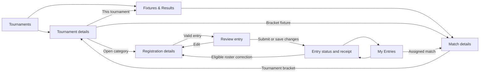

# UniSports MVP plan

**Implementation plan · FAST-NUCES Lahore · Frontend prototype**

UniSports should let a student answer three questions in one place. *Can I enter this tournament? Did my entry go through, and what do I do next? When and where is the match now?* A spectator should be able to answer the last question from a phone without registering. These outcomes determine what earns a place in the MVP.

## 1. Scope and evidence

The MVP covers **one campus, one season and seven sports and games**. Football, cricket and volleyball share the captain-led team flow. Badminton and table tennis each offer men’s singles, women’s singles, men’s doubles and women’s doubles. Include mixed doubles for badminton only in this edition. Ludo and chess offer solo entry only and reuse the individual registration form. All seven use the same tournament and match pages. The expanded lineup is the team's decision after the three-sport proposal. The original discovery, registration and match-finding tasks still define the scope.

| User and context | Research evidence | MVP priority |
| --- | --- | --- |
| Ayesha, individual participant, checking between classes | 8 of 21 individual participants found instructions or deadlines their hardest task. One interviewee knew Intra FAST was happening and still missed the deadline. | Primary walkthrough. Find a suitable event, decide whether to enter, submit and explain the remaining verification step. |
| Hamza, captain entering a team | 5 of 15 captains named roster submission or correction as their hardest task. 9 of 15 mainly used a laptop or desktop. | Enter a roster, correct one player's roll number without retyping the team, then find the team's next fixture. |
| Sana, spectator on her phone | 16 of 18 spectators mainly used a phone. For 9 of 18, finding a time or venue was hardest. The project team observed that some match information reached only registrants. | Go straight to public fixtures, find the current venue and later check the winner. |
| Bilal, organizer, working with the sports office | The officer described verifying fees and passing changes through captains. Interviewees described delays and missed updates. | Represent the information Bilal would publish through predefined statuses, fixtures and results. His management workflow is a future scope decision. |

Across the survey, 43 of 54 students checked multiple sources, and only 29 of 54 completed their task independently. This is the rationale for keeping tournament rules, entries and fixtures linked. These figures describe the existing campus process. Prototype testing will establish its own results. [Phase 2 report](UniSports_Phase2_Report.docx) · [Survey responses](FAST%20NUCES%20Lahore%20Campus%20Sports%20Survey.csv)

## 2. Navigation and page inventory

Use three main destinations, **Tournaments**, **Fixtures & Results** and **My Entries**. Tournaments doubles as the home page. A spectator can open Fixtures & Results directly. An individual participant and a captain start in the same place, then the selected event determines the appropriate form. My Entries represents one example student on the current device.

| Page | How the user gets there | Main outcome |
| --- | --- | --- |
| 1. Tournaments | Home or main navigation | Find an event worth opening |
| 2. Tournament details | Tournament list, entry detail or public link | Decide whether to register or follow matches |
| 3. Registration details | Open event's registration action, or Edit from review | Complete the individual, pair or team form |
| 4. Review entry | Continue from a valid registration form | Check the exact entry and submit it once |
| 5. Entry status and receipt | Successful submission or an item in My Entries | Understand what was received, its status and the next step |
| 6. My Entries | Main navigation or receipt | Return to a submitted entry and its relevant matches |
| 7. Fixtures & Results | Main navigation, tournament or entry | Find an upcoming match or completed result |
| 8. Match details | Fixture, result, bracket or relevant entry | Check a particular match, its latest change or its outcome |

The individual, pair and team forms are variants of page 3. The receipt and returning status view share page 5. Upcoming, Results and the tournament bracket are views within existing pages. This keeps the navigation small while giving every task an identifiable destination.

### 1. Tournaments

- Open on the current campus season. List each available tournament with its sport and category, entry type, eligibility summary, registration deadline and open or closed status.
- On mobile, lead with open tournaments ordered by the nearest registration deadline. Follow with today’s fixtures, or the next scheduled fixtures when none are due today. Once all registrations close, lead with fixtures. Keep **Fixtures & Results** one tap away in the same navigation position throughout the season. When a match changes, show the revised time or venue beside the affected fixture and link to its match details.
- Let students narrow the list by sport and category, including men's, women's, mixed and open events. Show the campus eligibility summary before they open an event. A student chooses which categories to browse. A roll number identifies an entry and does not determine category eligibility.
- Open a tournament by name. Returning from its details restores the selected sport. A closed tournament remains discoverable because its fixtures can still matter.
- If a selection has no events, explain the empty result and offer **Clear filters**. The public fixture destination stays available even when registration has ended.

### 2. Tournament details

- Answer the decision questions together. Who can enter? Which category is this? What is the deadline, including time? What is the fee, and is it per player, per pair or per team? What format, venue and participation rules apply? Include the Student Centre step where applicable.
- Use **Rs 200 per player** for solo events, **Rs 400 per pair** for doubles and **Rs 1,500 per team** for football, cricket and volleyball. These are project-selected amounts. Show the applicable amount and unit directly on the tournament, review and receipt pages. Before the form, explain: **Submit your entry online. Pay the entry fee at the Student Centre.**
- For a team event, explain captain responsibility, roster limits and whether the captain counts as a player, using the event's configured sample rules. For racket sports, list the available categories by their full names and show the selected category’s eligibility rules.
- Offer **Register as an individual**, **Register a pair** or **Register a team** for the selected event category. A student can enter multiple events in the same season, including singles and doubles in the same sport. Show **View my entry** for the category already entered. Keep registration available for every other open category for which the student is eligible. Once a category’s deadline passes, show **Registration closed**, the deadline and **View fixtures**.
- **View fixtures** opens the schedule filtered to this tournament. Give each public tournament a stable link students can copy into an existing campus group. Show whether copying succeeded and allow manual copying if necessary.
- Provide the predefined knockout bracket here, grouped by named round. Show known competitors, winners and undecided slots. A known fixture links to Match details. If the draw is unpublished, say so. A round-by-round reading order must work on a phone and with a keyboard.

### 3. Registration details

- Carry forward the event, deadline, fee and entry type. For the individual flow, ask for the participant's name and roll number. Ludo and chess open this solo form directly. For doubles, either player can register the pair. The form asks for the submitting player’s and partner’s names and distinct roll numbers. Review shows both names and the selected category. One submission creates one reference and one verification status for the pair. For the team flow, ask for team name, captain details and each required player's name and roll number. Additional fields need a verified purpose.
- Give each roster row an identifiable player and its own edit/remove action. Show the current count against the allowed range. Count a playing captain once according to the displayed rule. Preserve other rows when a player is changed or removed and allow a mistaken removal to be reversed.
- On **Continue to review**, check required values, the configured roll-number format, repeated IDs in the same roster and event-specific team size. Identify the affected field or player, explain the correction, focus the first error and retain valid values. The form can check entered data. The sports office verifies identity and eligibility.
- Preserve entered values when moving to review and back. A deliberate exit with unsaved work offers **Keep editing** or **Discard entry**. No cross-device draft or account is required.

### 4. Review entry

- Present a read-only summary of the tournament, selected category, participant or pair names, team name, captain and roster where relevant, fee, deadline and verification instructions. Use the same field names and player order as the form.
- Give each editable section a clearly named way back. Editing a roster entry returns the captain to that item with the rest intact. Continuing brings the corrected value back into review.
- Use **Submit entry** for the action that records the entry. Explain beforehand that submission creates a pending entry and state the next office step. Recheck registration availability and prevent repeated clicks or refresh from creating a second entry. If registration has closed, explain why submission stopped and link back to the tournament.

### 5. Entry status and receipt

- After a successful simulated submission, show **Entry received — pending verification**, an entry reference, the event, the participant, pair or team, and the applicable fee or office instruction. The receipt should let the student explain whether the office still needs to act.
- Reopening the record shows the same reference and status. Include a separate seeded **Confirmed** record to demonstrate the outcome after office verification. Elapsed time or clicking the receipt must never promote a pending entry.
- In the proposed campus workflow, a student or captain gives the office the entry reference when paying. Staff match the payment to the previously submitted entry and verify it. A pending receipt gives the amount due and where to pay, e.g. **If you haven’t paid yet, take your entry reference to the Student Centre and pay Rs 400 for the pair.** A confirmed receipt says the office has verified the entry. The frontend walkthrough uses two distinct records to show these states. Office processing occurs outside the student interface.
- For a team entry that is pending verification while its category is open, **Edit roster** reopens the populated roster form. The captain reviews corrections and selects **Save changes**. Recheck the status and deadline at save time. A successful save shows **Roster updated** on the receipt and preserves the entry reference and pending status. Cancelling the edit keeps the previously submitted roster. If the entry is confirmed or registration has closed, show the reason and direct the captain to the Student Centre for corrections.
- Offer **My Entries**, tournament details and relevant fixtures. If a fixture has yet to be assigned, explain that it has not been published for this entry. Keep roster and student identifiers within the demo entry flow.

### 6. My Entries

- List entries for the example student, including those submitted during the demo. Identify each by tournament, category, participant names or team name, and verification status. A doubles entry lists both players together. Selecting one opens its receipt.
- Where a fixture has been assigned, link to the specific match. If that match has changed, identify it by opponent, revised time or venue and status. Another sport's unrelated delay should never appear as this student's personal update.
- An empty state explains where entries will appear and links to **Browse tournaments**. Make it clear that the example student's records are local to the demo device. Spectators can bypass this area entirely.

### 7. Fixtures & Results

- Default to upcoming fixtures in chronological order. Let anyone switch to completed results and filter by sport, team or individual participant, and date. Carry the tournament context when arriving from a tournament. Show active filters and provide **Clear filters**.
- For each fixture, show the participating players, pairs or teams when known, the sport or tournament, round, date, current start time, campus venue and status. For a delay with no revised start, say **Revised time pending**. For a reschedule, make the replacement time or venue explicit.
- Results show the final score or sport-appropriate outcome, winner and round. Selecting any published fixture or result opens Match details. Back returns to the same view and filters.
- Distinguish **No matches match these filters** from **Fixtures have not been published**. The first offers a filter reset. The second offers a route back to tournament information.

### 8. Match details

- Identify the competing teams, doubles pairs or singles players, tournament, round, current date and time, venue and status. Include a stable public link the captain can share. Public pages use display names and omit roll numbers and private roster details.
- For a changed match, show what changed, the previous and current arrangements, and when the update was posted. If the replacement time is unknown, identify it as pending everywhere the match appears.
- For a completed match, show the recorded outcome, winner and corresponding knockout round. Link back to the tournament bracket and the filtered fixture list. An unknown match link should offer a route to **Fixtures & Results**.

## 3. Frontend behavior and demo content

| Item | Planned behavior |
| --- | --- |
| Tournament | Owns the sport, category, published entry rules, deadline, fee basis, format, venue and registration window. All pages read the same event information. |
| Entry | Belongs to a specific tournament and event category. The example student can submit several entries in one season. Each submitted entry has its own reference and verification status in My Entries. A form stays a draft until submitted. A separately prepared record demonstrates confirmation. |
| Match | Owns participants, round, latest schedule, any prior schedule, update time, status and result. Fixtures, bracket and My Entries refer to that same match so a venue change cannot disagree across pages. |
| Demo storage | Use fictional records and browser-local storage for submitted entries. Refresh restores a submitted entry. If saving fails, keep form data available for retry and show the receipt only after the save succeeds. Give testers fictional details in their task brief. Explain device-local storage in My Entries. |
| Season clock | Use 2 December 2026 at noon, Lahore time, for the presentation. Show the board date above the fixtures. Compare all deadlines, match times and change notices against that same clock. Use a later clock in QA to check closed registration and the fixture-first homepage. |

**Scope boundary.** Public schedules and entry-specific change notices represent the student-facing part of Phase 2's update scenario. Following sports, outbound notifications, messaging and organizer editing are deferred. Sharing uses an ordinary public link. Real authentication, payments, online ID checks, automated draws, live scoring, recruitment and full student profiles are outside the proposal's MVP. The frontend will use plain HTML, CSS and JavaScript with mock data. [Phase 1 proposal](UniSports_Sample_Proposal.docx)

### Event rules and season content

The fees, roster limits, dates, venue labels and match records below are production decisions for the classroom prototype. The survey establishes the need to publish these details. It does not establish official FAST regulations.

| Tournament | Entry rule for this edition | Registration closes (Lahore time) | Venue shown in the draw |
| --- | --- | --- | --- |
| Football | Open five-a-side, 5–8 players per squad | 3 Dec, 4 PM | Football Ground |
| Cricket | Open six-a-side, 6–9 players per squad | 4 Dec, 4 PM | Cricket Ground |
| Volleyball | Open six-a-side, 6–9 players per squad | 30 Nov, 4 PM | Volleyball Courts |
| Badminton | Men's and women's singles and doubles, plus mixed doubles | 3 Dec, noon | Indoor Hall, Badminton Courts |
| Table tennis | Men's and women's singles and doubles | 4 Dec, noon | Indoor Hall, Table Tennis Area |
| Chess | Open individual entry | 1 Dec, 4 PM | Activity Room |
| Ludo | Open individual entry | 3 Dec, 2 PM | Student Centre, Games Room |

Use currently enrolled FAST Lahore students as the participant group. Captains play and count once toward the squad limit. Store the captain as the first roster member and prefill their details. Either partner can register a doubles pair. For mixed doubles, publish the one-man, one-woman rule with the category description. Use self-selection at entry and office verification. Spectating is public. Accept roll numbers such as `24L-0123`, trim spaces and normalize letter case before comparing IDs. Within the available local entries, a student can appear once in a given category and can enter other categories. Identify a duplicate at the relevant player and never reveal another entry's private roster.

Use one two-sided knockout draw per category. For this edition Ludo uses head-to-head games. Each completed fixture records an advancing side. A chess draw awaiting a tiebreak keeps the advancing slot undecided. Only published outcomes populate later rounds. Open categories can show **Draw will appear after registration closes**. Newly submitted teams stay pending and unassigned. Link assigned matches using entry and competitor identifiers so a similar team name cannot attach the wrong fixture.

**One connected demonstration.** On 2 December the open-event list starts with badminton, which closes at noon the next day. A student submits a badminton pair, gets one reference and sees the Rs 400 payment instruction. A separate confirmed volleyball entry belongs to *Falcons*. Its semifinal against *Rovers* moved from 3 PM on Court 1 to **4:30 PM on Court 2**. Publish the change at 11:15 AM on the board date. The fixture list, receipt link, bracket and My Entries must all lead to that match. Include a completed chess quarterfinal with a recorded winner, an unaffected scheduled volleyball semifinal and a delayed fixture awaiting a time. This gives the presenter credible tasks even with the network disconnected after loading the local app.

### Screen presentation

**Visual direction.** Treat UniSports as the campus meet programme. On the tournament board, a cobalt masthead carries the board date and a lime ticket links directly to the next closing sport. Once registration ends, that ticket links to fixtures. The running-lane motif stays behind the masthead, keeping times, names and controls on plain surfaces. Use warm paper `#F7F7F1`, ink `#191E28` and cobalt actions `#253DB4`. Pair each sport symbol with its name and each status color with a written state.

**Brand identity.** Use UniSports as the product name and primary brand. Show **FAST Lahore** as the campus identifier so students can tell which tournaments the portal covers.

**First screen.** On a phone, show the three named destinations, the next deadline and the filters before **Open for registration**. Group open categories under their sport so nine racket categories do not bury the other games. Give each sport row its earliest available deadline, fee basis and a link to its categories. Follow with **Today's fixtures**. On a laptop show those two sections side by side. Give the revised time the strongest emphasis inside a changed fixture. The original time belongs in Match details. Every homepage row opens an event or match. The board date, deadlines and team names supply the copy.

**Type and controls.** Use locally bundled Bricolage Grotesque for headings and DM Sans for form labels, fees, dates and schedules. Start body text at 16 CSS pixels and align times with tabular numerals. Stack each player’s labelled fields on a narrow phone. Keep one horizontal row per player when space permits. Keep all three navigation labels visible on both sizes. Use native links, buttons and inputs. Aim for 44 by 44 CSS pixels for touch actions, include a visible keyboard focus outline, check at 320 CSS pixels and at 200% zoom, and ensure ordinary text reaches a 4.5 to 1 contrast ratio. Use inline status changes and preserve focus during updates.

**Registration progress and recovery.** Show **1 Details → 2 Review → 3 Receipt** with the current step announced to assistive technology. Use **Discard changes?** only when leaving a changed form. Return focus to the triggering control after cancelling the dialog. A duplicate ID produces field-level guidance such as **This roll number is already listed for player 2**. During a save, guard against double submission. On success, focus the receipt heading. On failure, keep the draft and offer **Try again**. These states supply the handout's progress indicator, dialog and message box within a real task.

**Implementation.** Serve static HTML, CSS and JavaScript from a local web server. Use one small shared navigation shell and hash links for public tournament and match destinations. Encode filters in the fixture URL so Back, refresh and copied links preserve the intended view. Put tournament categories, deadlines, fee rules, competitors and fixture records in one local data module. Use the same formatting and status logic on every screen. Keep only fictional submitted records in versioned local storage and keep roll numbers out of URLs. Offer an empty-state fixture for testing and seed the presentation with the confirmed entry described above.

## 4. How the plan applies the HCI course

| Norman principle | Observable behavior to inspect |
| --- | --- |
| Visibility | Before starting a form, Ayesha can point to eligibility, the deadline and the fee. After submitting, she can locate the status and remaining office step. |
| Feedback | Submission produces a persistent reference. An invalid roll number produces a specific correction beside the affected player. Copying a tournament link reports the outcome. |
| Constraints | The event determines the form. Closed registration stops submission. Roster limits and duplicate checks prevent an invalid team entry. |
| Mapping | **Edit player** acts on the named roster member. A fixture notice opens the match it describes. A tournament's fixture link carries that tournament into the schedule. |
| Consistency | **Pending verification**, **Confirmed**, **Delayed** and **Rescheduled** carry the same meanings wherever each status appears. Dates, venues and roll-number labels follow one convention. |
| Perceived affordances | A student can recognize a tournament name as a link, an action such as **Add player** as a button, and a status such as **Pending verification** as information. Controls have visible names and familiar behavior. |

**Norman's two gulfs give us two practical walkthrough questions.** For execution, can Hamza tell how to correct player three without abandoning his entry? For evaluation, can Ayesha tell whether “received” means she is cleared to play? Showing the editable player, retaining the roster and explaining the outstanding office step put the necessary knowledge on screen. [Norman lectures and course examples](skills/applied-hci/references/lecture-notes.md)

Apply Shneiderman's closure and reversal to the receipt and roster corrections. Apply Mandel's user control and reduced memory load by preserving form values and schedule filters. Group requirements before the registration action, order review fields like the original form, and align comparable match facts. For universal usability, require keyboard operation, meaningful focus after validation, labelled inputs, text descriptions of statuses and a usable reading order for results and brackets. Test the public schedule on a phone and the roster by keyboard on a laptop. [Course skill](skills/applied-hci/SKILL.md)

## 5. Requirements cross-check

| Phase 2 requirement | MVP disposition |
| --- | --- |
| R01–R03 · discovery, eligibility, deadlines, fees and rules | Pages 1–2 support browsing and an entry decision. Pages 3–4 carry relevant terms forward. |
| R04–R05 · current fixtures and schedule states | Pages 7–8 show scheduled, delayed and rescheduled examples, with current time and venue wherever known. |
| R06 · targeted changes | Partial. Page 6 surfaces a change against an affected entry. Outbound delivery is deferred. |
| R07–R09 · registration, verification instructions and status | Pages 3–6 cover individual, pair and team entries, review, receipt and later lookup. |
| R10 · following events or sports | Deferred. Registered entries have relevant match links. Public sport filtering is available to spectators. |
| R11 · public results | Pages 2, 7 and 8 connect results to the tournament and its bracket. |
| R12 · corrections | Pages 3–4 support correction before submission. From page 5, captains can also correct a submitted roster while the entry is pending verification and its category is open. |
| R13 · sharing | Pages 2 and 8 provide public links suitable for pasting into existing groups. Social-platform integrations are deferred. |

## 6. Evaluation and completion

Run the proposal's formative test with approximately five students, covering the three student roles. Use fictional names and roll numbers. Give each tester a starting situation and an outcome to achieve without naming the controls. The suggested targets below are planning targets to review with the group. Record how many participants actually attempted each task.

| Task and starting point | Pass condition |
| --- | --- |
| From home, decide whether to enter badminton and submit a sample entry. | The student finds eligibility, deadline and fee, submits once, reopens the entry and correctly explains pending verification and the next step. |
| From the football event, enter a team, encounter a duplicate roll number and correct a different player during review. | The captain identifies the affected row, preserves the rest of the roster and submits the intended team exactly once. |
| From My Entries, correct one player's roll number on a pending team entry before the deadline. | Reopening the receipt shows the corrected number, the original reference and pending status. On a confirmed or closed example, the captain can identify where to request a correction. |
| From the public schedule on a phone, locate a match whose time or venue changed. | The spectator gives the current date, time and venue unaided. The old arrangement is recognizable as superseded. |
| From a tournament, find a completed result and its knockout round. | The spectator identifies the winner and round. The bracket and match record agree. |
| From My Entries, find a team's changed match and compare it with an unaffected event. | The captain identifies which team is affected. The unaffected event retains its original status. |

Suggested targets are at least 80% unaided completion for each task attempted by five testers, correct interpretation of pending versus confirmed by everyone who submits, and zero lost roster rows or duplicate records in the correction test. Record raw counts for smaller groups, elapsed time, errors, requests for help and one short confidence rating with the user's reason. Retest any wrong-venue, lost-work or false-confirmation issue after revision.

**Delivery sequence**

1. Start the wireframes with the sport and category rules above. Storyboard three moments from Phase 2: Ayesha deciding whether to pay, Hamza correcting a roster and Sana finding the revised venue. Give each frame a user goal, action and visible response.
2. Sketch the eight screens and their exceptional states. Compare a separate whole-roster editing screen with direct access to a named player from review. Compare a general changes feed with placing the revision on the affected fixture. Start with the named-player link and inline change. Test whether students can find both, and keep the alternate sketches and the reason for the final choice.
3. Connect discovery and public fixtures first. Then connect the individual, pair and team registration variants, review, receipt and My Entries. Use the same sample matches in the bracket and the change notices.
4. Walk through the normal and exceptional paths on phone and laptop, including keyboard-only use, closed registration, a duplicate player, back/edit, empty filters, delay without a replacement time, refresh after submission and an unavailable match link.
5. Run the student tasks and inspect all ten Nielsen heuristics using the course workbook. Record evaluator, task, screen and step, observation, impact, recommended change and retest. Keep participant findings separate from inspection findings. For the proposal's predictive evaluation, model the registration goal with GOMS and use KLM to compare two methods for one familiar action, such as correcting a player's roll number.
6. Assemble the high-fidelity frontend, wireframe-to-final examples, completed evaluation workbook and revision evidence. The Phase 4 rubric allocates **5/20** to high-fidelity design, **4/20** to navigation and interaction, **3/20** to content and principles, and **8/20** to the workbook. [Course evaluation reference](skills/applied-hci/references/project-evaluation.md) · [Phase 4 handout](Course%20Materials/Project%20Phase%204.pdf) · [Heuristic evaluation workbook](Course%20Materials/Heuristic_Evaluation.pdf)

The MVP is ready to present when each persona can complete the relevant journey, the same entry or match gives the same answer everywhere it appears, and the group can show what changed in response to evaluation.

### Inspection and hand-in

Use these as inspection prompts when the frontend exists. Enter actual observations in the supplied workbook. Record the starting screen, action, evidence, impact, recommended correction and retest outcome. An inspected screen that passes can be recorded as such.

| Nielsen heuristic | What the evaluator actually tries |
| --- | --- |
| Visibility of system status | Submit the badminton pair. Ask what the reference proves and what still needs to happen. |
| Match with the real world | Find the Student Centre payment instruction and determine whether Rs 400 covers one or both players. |
| User control and freedom | Remove a teammate, undo it, then cancel a different edit. Reopen the original roster. |
| Consistency and standards | Compare the Falcons match time and venue on the public board, the bracket link and the captain's entry. |
| Error prevention | Enter the captain twice using different letter case. Try submitting an otherwise valid roster after the deadline. |
| Recognition over recall | Return directly to player three from review. Check that the other players and selected event remain visible or retrievable. |
| Flexibility and efficiency | Open a shared match link on a phone. On a laptop, complete a roster correction by keyboard. |
| Aesthetic and minimalist design | At phone width, identify the next deadline and the path to today's fixtures. Flag any element that delays either task. |
| Error recognition and recovery | Trigger a failed save. Check that the message gives an action, that retry preserves the draft and that only one receipt exists. |
| Help and documentation | From a confirmed receipt, find the office correction instructions at the point where a captain would look for Edit roster. |

For each substantive revision keep one wireframe or before-screen, the finding that motivated the edit, the revised screen and a retest note. For the **5 design marks**, use these pairs to show typography, layout and color at phone and laptop widths. For the **4 navigation marks**, walk through the progress indicator, discard dialog and error recovery. For the **3 principles marks**, demonstrate the roster edit and pending receipt and explain the user's action and expected feedback. For the **8 workbook marks**, submit the completed official workbook with precise findings under all ten headings. The instructor allowed the HTML/CSS/JS frontend as the high-fidelity medium. Capture representative screens from that same build for the submission.
